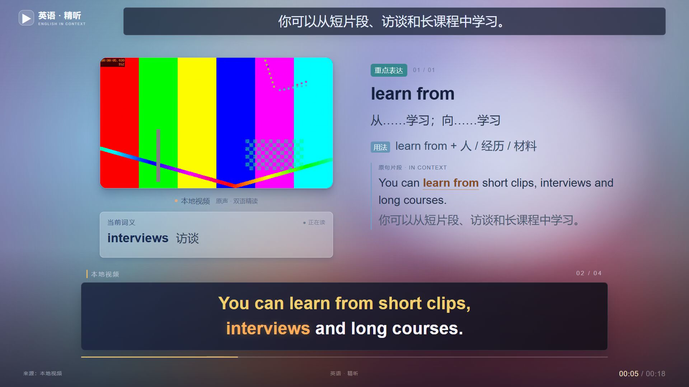

# 英语视频精读精听工作室

Windows 本地英语学习工具。导入视频、音频或公开视频链接，生成逐词高亮字幕、简体中文语境词义、句型讲解和离线学习页；需要时导出学习视频。

v0.6.3 后续新稿默认自制，手动新建和新建资源订阅均可单独改为转载；自制稿继续保留原始来源与署名。已完成授权短片从YouTube获取、精听制作、官方网页投稿和本机回执登记，并实际核对公开播放；本机直接投稿接口仍未连通。现有配置、课程、进度和收藏沿用。[更新说明](docs/RELEASE-v0.6.3.md)与[验收记录](docs/VALIDATION.md)记录实际边界。


想先看效果：下载并完整解压后，打开 [原创合成演示学习页](demo/lesson/study.html)，或播放 [18秒演示视频](demo/lesson/lesson.mp4)。请保留整个 `demo/lesson/` 文件夹。演示的脚本、测试画面和系统合成语音均已标明来源，真实节目不随源码分发。

下图直接取自演示成片；左侧彩条是测试素材，可替换为导入视频的原画面。[窄屏学习页局部](docs/images/preview-study.png)展示了词义、讲解和播放控制。



## 开始使用

1. 安装 **Python 3.11–3.13、Node.js 22.12+（或20.19系列）、FFmpeg、Chrome或Edge**。确认 `ffmpeg`、`ffprobe` 在 PATH 中。
2. 下载并解压本项目，双击 `install.bat`。依赖安装在本项目的独立环境。
3. 双击 `start.bat`，浏览器会打开 <http://127.0.0.1:8775>。制作期间保留启动窗口；关闭网页后任务仍可继续，关闭服务则会中断当前处理。
4. 在“设置”填写可用的 DeepSeek 官方接口或本机 OpenAI Chat Completions 兼容网关，验证后保存。密钥在本机使用 Windows DPAPI 加密。
5. 选择视频或音频，可另外选择英文字幕；或粘贴链接。点击生成后，在任务区查看进度、检查问题并打开学习页。

首次安装需要联网下载依赖，首次识别还需下载语音模型。自动检查GPU运行条件，优先复用本机完整缓存的大模型和独立环境CUDA运行库；显存不足或运行库不可用时回退到CPU。可选GPU依赖见 `requirements-gpu.txt`，不修改系统PATH或已有模型接口配置；处理时间取决于素材长度、硬件与模型接口。只播放已生成的学习包不需要安装环境或连接模型接口。

## 可以学什么

- MP4、MKV、MOV、WebM 等可解码视频，及常用音频文件。
- 英文字幕可选，支持 SRT、VTT、ASS、SSA、TXT、PDF。没有字幕时直接从原声识别；有字幕时会与原声核对，不直接相信字幕时间。
- BBC 官方节目、YouTube、B站和可访问的媒体链接。来源使用独立适配器，平台访问条件变化可能造成获取失败；可改用本地文件。
- 本地文件按8 MiB上传，支持断点恢复。默认单媒体上传上限20 GiB、字幕上限20 MiB；网络来源下载另有12 GiB总量限制。媒体本身必须有有限时长和可辨识英语人声，直播不作为本版输入。
- 可选择音轨与起止范围。本地上传自动采用单音轨或唯一明确的英语轨；其他多音轨素材先试听再选择。链接素材未指定音轨时沿用来源或媒体默认选择，不能保证自动识别语言。音轨索引使用媒体探测的全局 `stream.index`，并非从零排列的“第几条音轨”。

如果用TXT/PDF配合裁剪片段，请提供对应片段稿；这两种无时间信息的格式不能自动精确定位整篇文稿。

## 精读精听

- “本章讲解”和“逐句精听”各有独立滚动区，默认跟随播放器定位当前卡片和句子。手动浏览会暂停跟随，点击“回到当前”恢复；也可关闭单个列表的跟随。
- 课程按实际内容生成主题目录，展示起止时间、主题和简体中文摘要。边界来自原句已有时间，点击即可回听；模型接口不可用时保留原学习单元。

原画面与讲解并排，字幕随原声逐词高亮；可切换卡片布局。支持单句回放、单句循环、A–B循环、句末暂停、倍速、隐藏中文、全文搜索、章节导航、点词查义、收藏和CSV导出。

视频播放器是唯一播放时钟；字幕、当前词义及讲解卡都从同一时间推导。纯音频使用音频播放器。切换布局不创建第二路声音。

长视频按约5分钟处理和组织学习单元。20分钟以内默认同时导出MP4，超过20分钟先生成学习页、字幕及笔记，可按需导出全片或选中范围，避免必须等待整片渲染才能开始学习。

每份学习包在 `outputs/<素材编号>/`，包含：

| 文件 | 用途 |
|---|---|
| `study.html` | 离线学习页，保留同文件夹媒体即可使用 |
| `source.mp4`（视频素材）/ `audio.mp3` | 归一后的本地原画面及原声 |
| `episode.json` | v4可重用教学数据、词语时间与章节 |
| `subtitles.en.srt`、`subtitles.zh.srt`、`captions.ass` | 中英字幕及高亮字幕 |
| `study-notes.md`、`vocabulary.csv` | 精读笔记和重点词表 |
| `lesson.mp4`（请求导出后） | 1920×1080、30fps学习视频 |
| `exports/clip-*.mp4`（片段导出后） | 独立导出片段 |

离线使用无需模型接口。学习进度和收藏保存在当前浏览器，重要生词请定期导出；更换浏览器、地址或清理数据可能无法沿用。

## 检查与恢复

识别、对齐、讲解、复核及导出保留检查点。暂停通常在当前步骤的安全检查点生效，模型请求不会立即中断。恢复时复用有效结果。

疑似错词、字幕不匹配、零时长或重叠会进入待检查。检查列表可直接回听对应时间并查看识别词与参考词，按单元修正，其他通过的单元可以先学；有问题的范围不能导出。修改文字后重新对齐相关章节，禁止混用旧时间和新文字。参考稿差异只比较全片一次，再定位到单元；说话人标签保留为元数据，不当成对白。只有绑定当前音频、模型与争议内容的独立无提示原声证据可以自动解决参考稿删节，参考词被支持时仍须真正修正文稿。

模型不生成时间戳。自动检查及模型复核有助发现问题，不能证明所有识别、翻译和语法解释都正确。版本的实际验证范围见 [验收记录](docs/VALIDATION.md)。

项目私有资料默认位于 `work/profile/`，可用 `ENGLISH_VIDEO_DATA_DIR` 指定其他目录。备份前暂停任务并关闭服务，保留整个 `work/`、`outputs/` 和所用版本源码；若自定义资料目录，也要完整备份。恢复时放回原目录，再启动服务并在任务区恢复。仅复制成品不包含任务检查点。DPAPI密钥绑定当前Windows用户；换用户或电脑需要重新填写。通用版没有自动创建每日追更任务。

如果安装失败，检查上述环境和联网条件后重新双击 `install.bat`。如果素材获取失败，可导入已合法取得的本地文件。需要排错时，只提供版本、错误类型和脱敏步骤；不要公开整份运行目录。

## 开发与测试

```powershell
.\.venv\Scripts\python.exe -m unittest discover -s tests -v
npm ci
npm run build
.\.venv\Scripts\python.exe app.py --port 8775
```

GitHub Actions检查模板保存在 `docs/ci/windows-checks.yml`。维护者取得工作流写入权限后，可将其放入 `.github/workflows/` 启用；本次发布没有声称云端检查通过。

数据流和模块边界见 [架构约定](ARCHITECTURE.md)。本项目沿用已有BBC版的识别、排版和教学组件，v3学习数据兼容读取；通用版运行资料与旧版隔离。

## 隐私与开源

语音识别在本机进行；字幕文字、标题及相关上下文会发送给你配置的模型接口，用于生成和复核讲解。原视频不会为此上传给语言模型。

仓库和发布包排除本机密钥、接口配置、任务数据库、日志、个人素材与制作缓存。真实验证素材不随源码分发。安全报告方式见 [SECURITY.md](SECURITY.md)，依赖与素材许可见 [THIRD_PARTY.md](THIRD_PARTY.md)。Remotion、PyMuPDF、B站接口库等分别有自己的许可条件；本项目的MIT许可不能替代这些条件。

项目自己的源码采用 [MIT许可](LICENSE)，第三方软件与素材分别遵循其许可。自动投稿须对具体来源明确开启并拥有素材发布权利；实际提交结果以返回的稿件编号和官方创作中心记录为准。

逐词验收工具与判定边界见 [同步验收说明](docs/SYNC-ACCEPTANCE.md)。自动测量、模型一致性与人工听辨分别记录，未填写人工边界时不会产生人工通过率。

## 资源订阅与B站投稿

在首页「资源订阅与投稿」展开设置。默认只发现素材；可分别开启自动制作和自动投稿。首次检查只取来源列表首条，后续按链接去重，超过单次上限的新资源留到下次。程序关闭时不检查，启动后补查到期来源。YouTube 需本机 Node 和匹配的 yt-dlp-ejs；安装入口会在独立环境补齐。RSS 需提供音频 enclosure 或可获取的媒体链接。

投稿先选课程、分区、标签和来源，确认发布权限后准备草稿。只有已导出且检查通过的精听视频可进入投稿；课程修订或文件改变会拒绝旧草稿。扫码登录仅新增本机加密的B站授权，不改变原模型连接。可直接打开本机的 `http://127.0.0.1:8775/bilibili-login.html`：实时换码、多页复用有效会话，后台接收手机确认。明确开启的投稿草稿会等待账号连接，工作区可暂停尚未开始的自动投稿。结果不明不会自动重投，可下载包含视频、封面和元数据的投稿包，并打开官方创作中心。官网下载投稿包完成投稿后，可在对应草稿展开“已在官网投稿？登记稿件号”，明确确认并登记BV号，后续不再自动提交同一成片。此功能是人工回执记录，不会读取浏览器Cookie或假定本机账号已连接。当前兼容上传适配器使用已安装的旧SDK，真实账号直接投稿尚未验证；其上游已停止维护。官方OAuth通道需要单独获批应用凭据，本版未假定用户已具备。

与同类产品的实查比较及本版可测差异见[差异化说明](docs/DIFFERENTIATION.md)。
